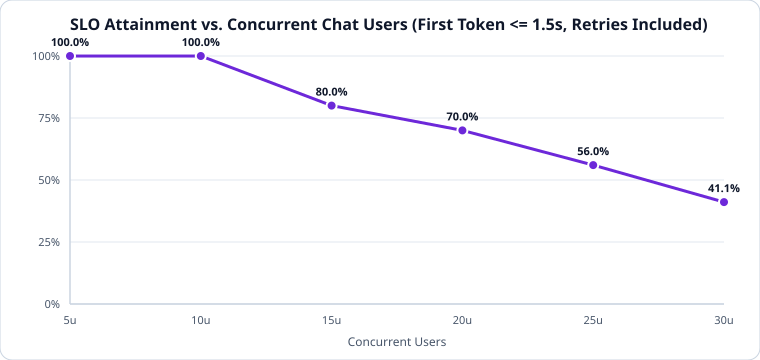

# LLM Gateway Bench

[](LICENSE)
[](https://www.python.org/)
[](https://fastapi.tiangolo.com/)
[](https://prometheus.io/)

**A production-shaped LLM chat gateway with bounded admission control, per-tenant fairness, token budgets, SQLite usage ledger, and Prometheus telemetry.** Overload is refused early with `503 Service Unavailable` + `Retry-After` so the upstream inference engine never builds an unbounded queue. Every number below was measured locally by `scripts/load_sim.py`, and every chart is generated directly from the result files.

| **10** | **100%** | **842 ms** | **7 / 7** |
| :---: | :---: | :---: | :---: |
| max concurrent decoding slots enforced at the gateway | SLO attainment at 10 concurrent users (`TTFT <= 1.5s`) | p95 time-to-first-token at full 10-slot saturation | failure & policy matrix tests passing (`pytest`) |

<picture>
  <source media="(prefers-color-scheme: dark)" srcset="docs/img/degradation-dark.svg">
  
</picture>

At 10 concurrent users, 100% of messages receive their first token within 1.5 s with zero `503` retries. Beyond the 10-slot concurrency cap (15–30 users), the gateway sheds excess load with `Retry-After` headers instead of letting head-of-line queueing collapse tail latency. Full tables: **[docs/RESULTS.md](docs/RESULTS.md)**.

---

## Architecture

<picture>
  <source media="(prefers-color-scheme: dark)" srcset="docs/img/architecture-dark.svg">
  
</picture>

**The gateway is the only limiter.**
- **Bounded concurrency (`MAX_CONCURRENT_SLOTS=10`):** Prevents upstream queue buildup.
- **Per-tenant fairness (`MAX_PER_TENANT_INFLIGHT=4`):** Stops a noisy tenant from starving other tenants.
- **Policy enforcement:** Rejects missing auth (`401`), missing tenant (`400`), oversized context (`413`), and exhausted token budgets (`429`) before touching the LLM.
- **Pluggable backend:** Runs with a deterministic concurrency-aware mock engine for CI/load testing, or proxies live SSE streams to any OpenAI-compatible server (Ollama, Groq, vLLM).

---

## Quickstart

```bash
python3 -m venv .venv
source .venv/bin/activate
pip install -r requirements.txt

# 1. Run failure & policy matrix tests
pytest -v

# 2. Run multi-user load simulator & regenerate SVG charts
python scripts/load_sim.py
python scripts/generate_charts.py

# 3. Start the gateway locally
uvicorn app.main:app --host 0.0.0.0 --port 8000
```

### Connecting a Real Free-Tier / Local LLM (Optional)
```bash
export UPSTREAM_MODE=openai_compatible
export UPSTREAM_BASE_URL=http://localhost:11434/v1   # e.g. Ollama, or Groq/OpenRouter
export UPSTREAM_API_KEY=ollama
export UPSTREAM_MODEL=qwen2.5:1.5b
uvicorn app.main:app --port 8000
```
